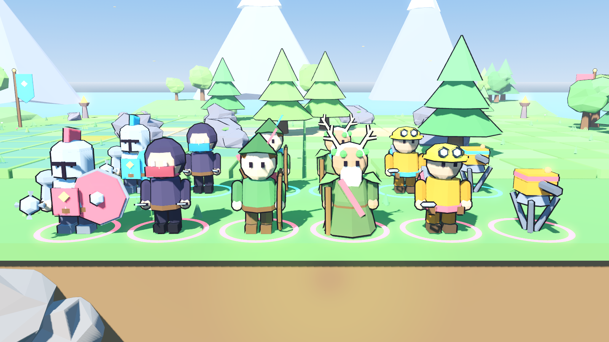
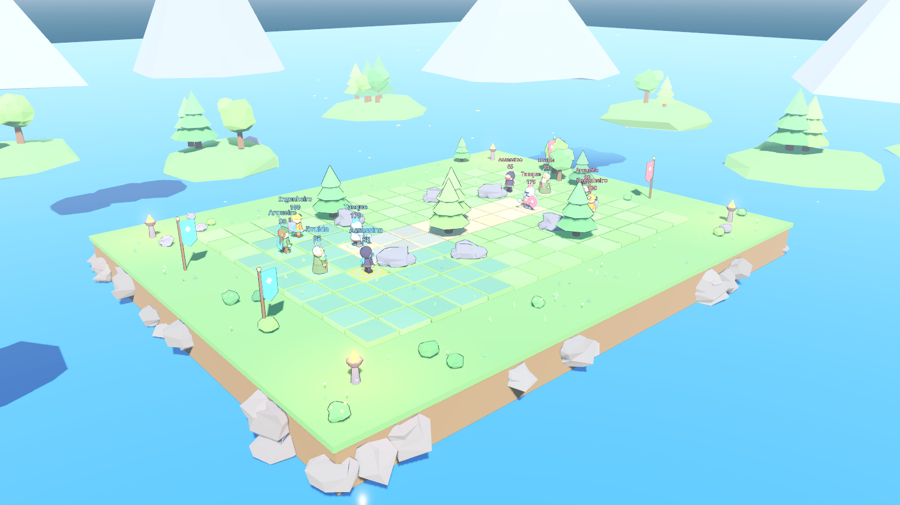

# Kopa

Jogo tático PvP por turnos em Godot 4.3. Cada jogador controla 5 personagens
(Tanque, Assassino, Arqueiro, Druida e Engenheiro) num tabuleiro 3D com câmera
estilo MOBA. O golpe que vence a partida não é encenado na hora: ele dispara uma
cinemática da partida inteira, do primeiro turno até o golpe final.



Visual low poly cartoon, todo gerado em código (sem arquivos de modelo): malhas facetadas,
sombreado em faixas e contorno escuro. Os números de balanceamento são um ponto de partida.

## Como rodar

1. Abra o Godot 4.3 (ou mais recente da série 4.x) e importe a pasta do repositório.
2. Aperte F5. A partida é local: os dois jogadores revezam no mesmo computador.

Teste automático, com a IA jogando pelos dois lados até a cinemática:

```bash
godot --path . -- --autoplay
```

Teste só da cinemática: simula a partida inteira na lógica (sem animação), toca a cinemática
em velocidade normal, depois testa "Rever cinemática" com "Pular" no meio da montagem, no começo
da câmera lenta, no congelamento do golpe final e logo no início, e revê uma vez inteira acelerada.
Imprime cada plano escolhido e `CINE_TEST_OK` no fim. Com uma pasta, salva capturas a cada 0,4 s (nome com a fase:
abertura, montagem, final, congelado, retomada, revelacao). `--seed=N` repete a mesma partida;
`--cine-final` acelera a montagem e deixa só o trecho final em velocidade normal (para iterar no golpe final).

```bash
godot --headless --path . -- --cine-test --seed=7
godot --path . --resolution 1600x900 -- --cine-test=/caminho/da/pasta --seed=7
```

Para gerar as imagens de vitrine (personagens e cenário) numa pasta:

```bash
godot --path . -- --showcase=/caminho/da/pasta
```

## Visual

| Classe | Referência de design |
| --- | --- |
| Tanque | Cavaleiro pesado: elmo com viseira e penacho, ombreiras, escudo grande, maça |
| Assassino | Capuz pontudo, rosto coberto, olhos brilhando, cachecol, duas adagas |
| Arqueiro | Chapéu de caçador com pena, capa, aljava nas costas, arco longo |
| Druida | Manto, barba, chifres com coroa de folhas, cajado com orbe verde brilhante |
| Engenheiro | Capacete com óculos de proteção, mochila com chaminé e engrenagem, chave inglesa |

A cor do time aparece nas peças de destaque (tabardo, escudo, cachecol, capa, faixa, cinto)
e no anel aos pés de cada personagem.

O cenário é um platô gramado sobre um lago, com ruínas, pedras e pinheiros como obstáculos,
estandartes e braseiros nas bases, ilhas com árvores, montanhas ao fundo, nuvens e folhas caindo.



Arquivos: `scripts/world/lowpoly.gd` (estilo), `character_builder.gd` (personagens),
`props.gd` (peças de cenário), `scenery.gd` (cenário em volta), `arena.gd` (tabuleiro).
Para trocar por modelos feitos em Blender, basta mudar `unit_view.gd`.

## Controles

| Ação | Tecla |
| --- | --- |
| Mover a câmera | WASD ou setas, ou arrastar com o botão do meio |
| Aproximar / afastar | Roda do mouse |
| Girar a câmera | Q / E |
| Centralizar no personagem da vez | F |
| Modo mover | M |
| Habilidades | 1 e 2 |
| Confirmar alvo / destino | Botão esquerdo |
| Cancelar | Botão direito ou Esc |
| Encerrar turno | Espaço |

## Regras atuais

- **Ordem de iniciativa alternada.** No início de cada rodada, cada jogador ordena
  seus personagens vivos por iniciativa. Os jogadores se alternam: o mais rápido
  do J1, o mais rápido do J2, o segundo do J1 e assim por diante. Começa quem tem
  a maior iniciativa; no empate, quem começa alterna a cada rodada.
- **Turno do personagem:** andar (até o valor de Movimento) e usar 1 habilidade,
  em qualquer ordem. O turno acaba sozinho quando as duas coisas são feitas.
- Distâncias em quadrados (sem diagonal). Obstáculos bloqueiam movimento e linha de visão.
- Vitória: eliminar os 5 personagens do rival (a torreta não conta).

| Classe | Vida | Mov. | Inic. | Habilidade 1 | Habilidade 2 |
| --- | --- | --- | --- | --- | --- |
| Tanque | 170 | 3 | 3 | Golpe de Escudo: 18, empurra | Muralha: −50% de dano até o próximo turno |
| Assassino | 85 | 5 | 9 | Apunhalar: 26 | Execução: 20, dobra abaixo de 40% de vida |
| Arqueiro | 90 | 3 | 7 | Flecha: 17, alcance 6 | Chuva de Flechas: 12 em área 3x3 |
| Druida | 95 | 3 | 5 | Cura: +30 | Espinhos: 12 e enraíza |
| Engenheiro | 100 | 3 | 4 | Torreta: atira 10 no fim do turno dele | Granada: 16 em área 3x3 |

Todos os números ficam em `scripts/core/game_data.gd`.

## Arquitetura

```
scripts/
  core/      lógica pura, sem nada visual
    game_data.gd        classes, habilidades, balanceamento
    match_state.gd      regras, turnos, comandos e registro de eventos
    tactical_ai.gd      IA simples (teste automático e futuro modo contra a máquina)
  world/     tabuleiro, personagens e câmera de jogo
  game/
    event_player.gd     encena eventos (usado no jogo e na cinemática)
    cinematic_director.gd  cinemática do golpe final (montagem: planos e tempo)
    cinematic_camera.gd    câmera da cinemática (enquadramento e movimento)
  ui/hud.gd  interface
  main.gd    liga tudo e trata a entrada do jogador
```

- **O registro é a fonte de verdade.** Cada comando (`move_to`, `use_ability`,
  `end_turn`) resolve na hora, sorteios incluídos, e grava eventos em
  `MatchState.events`. O jogo só encena esses eventos.
- **Golpe final.** O evento que encerra a partida vem marcado com `final`. O
  `main.gd` não o encena: chama o `CinematicDirector`, que recria o tabuleiro no
  estado inicial e encena o registro inteiro em sequência, sem pausas nem legendas
  entre turnos. Só o último golpe entra em câmera lenta, congela no impacto e retoma.

## Câmera da cinemática

A câmera trabalha com **planos** (enquadramentos), não persegue pontos.

- **Montagem.** Antes de começar, o diretor lê o registro inteiro, simula as posições
  e agrupa os turnos em planos: um plano segura vários turnos enquanto a ação couber
  no mesmo quadro (de 1,5 s a 4,5 s) e corta na troca de personagem quando não cabe.
  Ação vizinha da anterior vira um movimento curto em vez de corte.
- **Enquadramento.** Cada personagem é uma caixa com o tamanho real do modelo. A
  distância sai do FOV: é a menor que põe todas as caixas dentro da área útil da tela
  (entre as faixas de cinema, com margem e espaço sobre a cabeça), com limites mínimo e máximo.
- **Ângulo.** Vários ângulos são testados por plano e vence o melhor: lateral ao eixo
  da ação, sem obstáculo (rochas, ruínas, pinheiros) nem personagem na frente, longe do
  cenário fora do tabuleiro. A câmera fica sempre do lado do público (regra dos 180°:
  Jogador 1 à esquerda, Jogador 2 à direita) e evita cortar para um ângulo quase igual.
- **Movimento.** Câmera estável; dentro do plano só um push-in lento. A pose é suavizada
  por mola criticamente amortecida, em tempo real (não sofre com `Engine.time_scale`).
  A orientação vem de yaw/pitch, sem `look_at`.
- **Golpe final.** Plano de preparação com o atacante e o alvo; no golpe, corte para um
  plano baixo (contra-plongée leve) com lente mais longa: lateral se estão perto, por cima
  do ombro do atacante se o alvo está longe. Push-in lento durante a câmera lenta e o
  congelamento (com um arco curto), deixando o terço de baixo livre para a legenda. Depois,
  a câmera se afasta para um plano aberto e estável do time vencedor.
- **PvP online (próximo passo).** Como toda a partida vem dos comandos, basta
  sincronizar os comandos entre os jogadores, com um servidor validando. Cada
  aparelho monta a cinemática localmente, sem transmitir vídeo.
